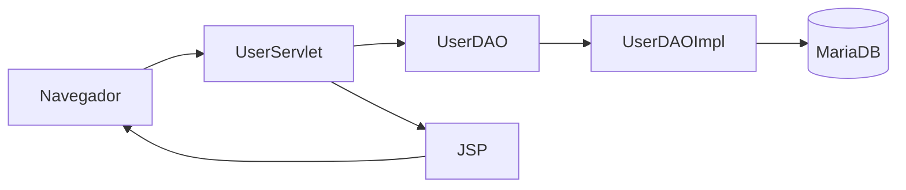

# CRUD de Usuarios


Aplicación web para la gestión de usuarios mediante un CRUD completo.

El proyecto permite crear, listar, editar y eliminar usuarios utilizando
Servlets, JSP, JSTL, JDBC, DAO y MariaDB.


## Características

- Listado de usuarios.
- Creación de usuarios.
- Edición de usuarios.
- Eliminación de usuarios.
- Validación de campos obligatorios.
- Validación de username duplicado.
- Conversión de tipos desde parámetros HTTP.
- Cálculo automático de `passwordExpiresAt`.
- Internacionalización en español e inglés.
- Uso de JavaDoc y loggers.

## Tecnologías

| Capa | Tecnología |
|---|---|
| Backend | Java 21 + Jakarta Servlets |
| Frontend | JSP + JSTL |
| Acceso a datos | JDBC + DAO |
| Base de datos | MariaDB |
| Servidor | Jetty 11 |
| Gestión | Maven |
| Contenedores | Docker |

## Instalación

Clona el repositorio:

```bash
git clone https://github.com/Danielqd07/dwese-user-crud-servlet-dqd.git
cd dwese-user-crud-servlet-dqd
```

Levanta la base de datos:

```bash
docker compose up -d
```

Compila el proyecto:

```bash
mvn clean install
```

Arranca Jetty:

```bash
mvn jetty:run
```

Abre la aplicación en:

```text
http://localhost:8080/users
```

## Funcionamiento

La aplicación sigue el patrón MVC.



## Validaciones

El formulario contiene validaciones HTML como:

```html
required
maxlength
min
```

En el servidor también se comprueba:

- Que los campos obligatorios no estén vacíos.
- Que el username no esté repetido.
- Que los intentos fallidos no sean negativos.
- Que las fechas tengan un formato válido.

## Cálculo de passwordExpiresAt

La fecha de caducidad de la contraseña se calcula en Java:

```java
passwordExpiresAt =
        lastPasswordChange.plusMonths(3);
```

De esta forma, la contraseña caduca tres meses después del último cambio.

## Internacionalización

La aplicación puede mostrarse en español e inglés.

Los mensajes se encuentran en:

```text
src/main/resources/messages.properties
src/main/resources/messages_en.properties
```

En las JSP se utiliza JSTL `fmt`.

Ejemplo:

```jsp
<fmt:message key="msg.user-list.title"/>
```

## Estructura principal

```text
src/main
├── java
│   └── org/iesalixar/daw2/danielquintero
│       ├── daos
│       ├── entities
│       ├── listeners
│       └── servlets
├── resources
│   ├── application.properties
│   ├── data.sql
│   ├── messages.properties
│   └── messages_en.properties
└── webapp
    ├── partials
    ├── views
    │   └── user
    └── WEB-INF
```

## Tareas pendientes

- [x] Crear la tabla `users`.
- [x] Implementar el CRUD completo.
- [x] Añadir validaciones.
- [x] Añadir internacionalización.
- [x] Añadir loggers.
- [x] Añadir JavaDoc.
- [ ] Mejorar los estilos visuales.
- [ ] Añadir autenticación.
- [ ] Cifrar las contraseñas.

> [!NOTE]
> La base de datos debe estar levantada antes de iniciar Jetty.

> [!WARNING]
> No deben utilizarse contraseñas personales o sensibles en archivos
> del repositorio.

## Preguntas frecuentes

<details>
<summary>¿Cómo arranco el proyecto?</summary>

```bash
docker compose up -d
mvn clean install
mvn jetty:run
```

</details>

<details>
<summary>¿Cómo se calcula passwordExpiresAt?</summary>

Se calcula sumando tres meses a `lastPasswordChange`:

```java
lastPasswordChange.plusMonths(3);
```

</details>

## Autoría

Daniel Quintero Díaz - 2º DAW - IES Alixar

GitHub: [Danielqd07](https://github.com/Danielqd07)

## Licencia

Este proyecto se distribuye bajo la licencia MIT.

Ver [LICENSE](LICENSE).

[^1]: El proyecto utiliza el patrón MVC para separar la vista, el controlador
y el acceso a los datos.
